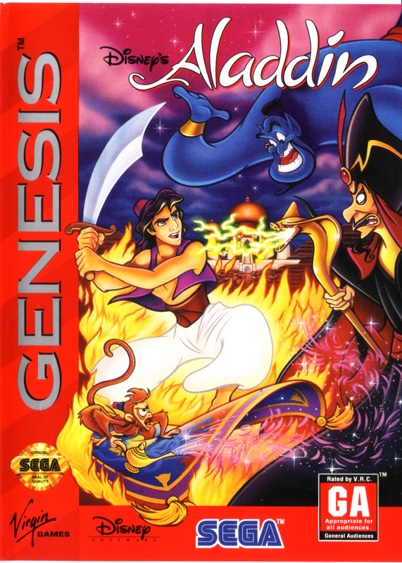
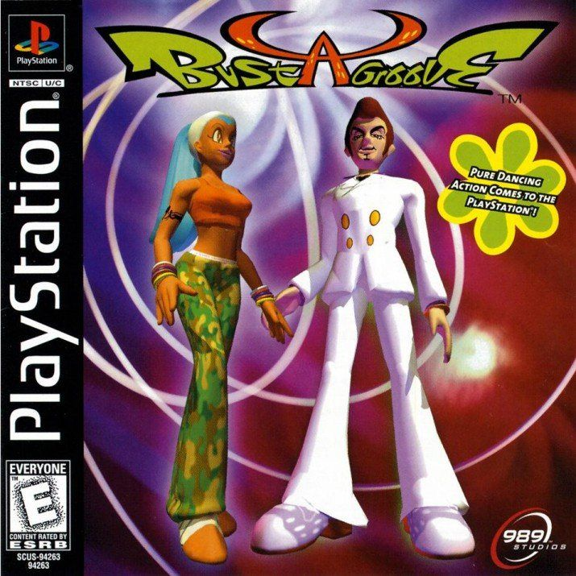
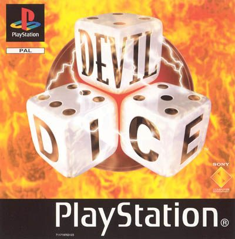
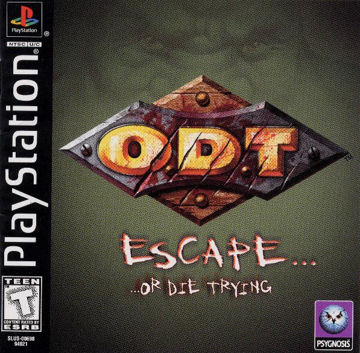
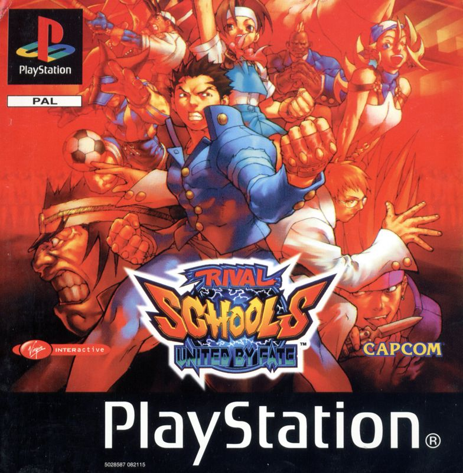
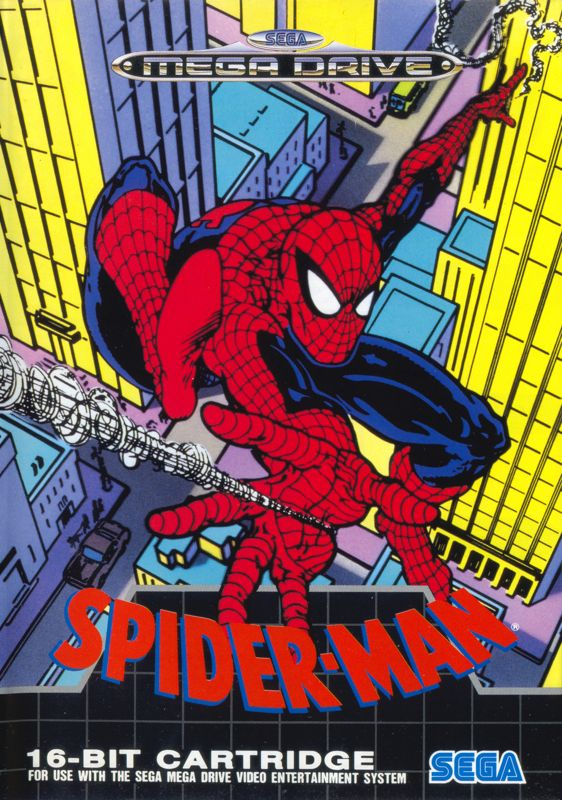
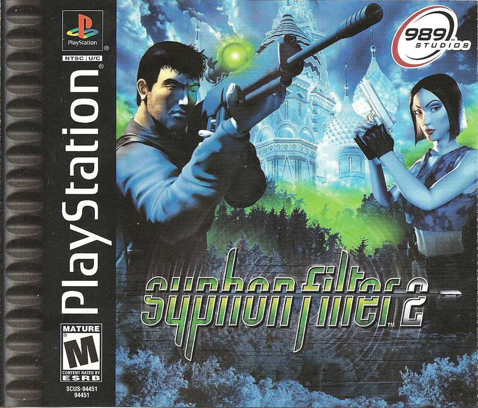
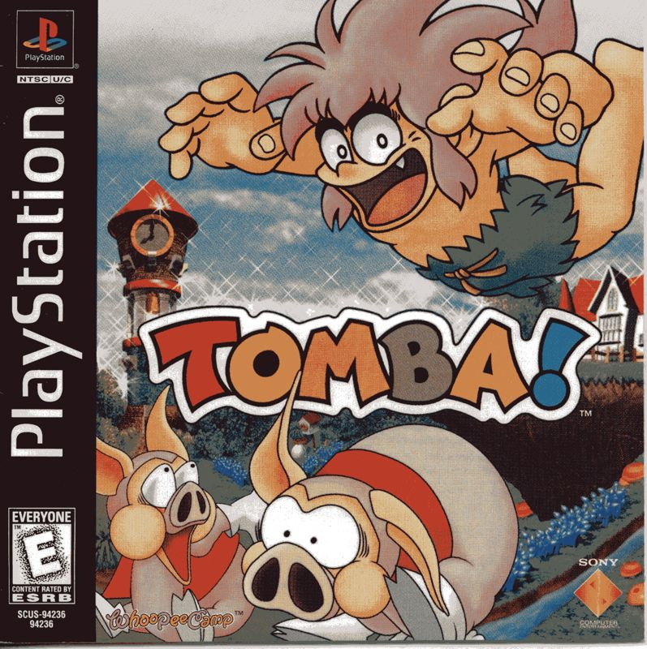
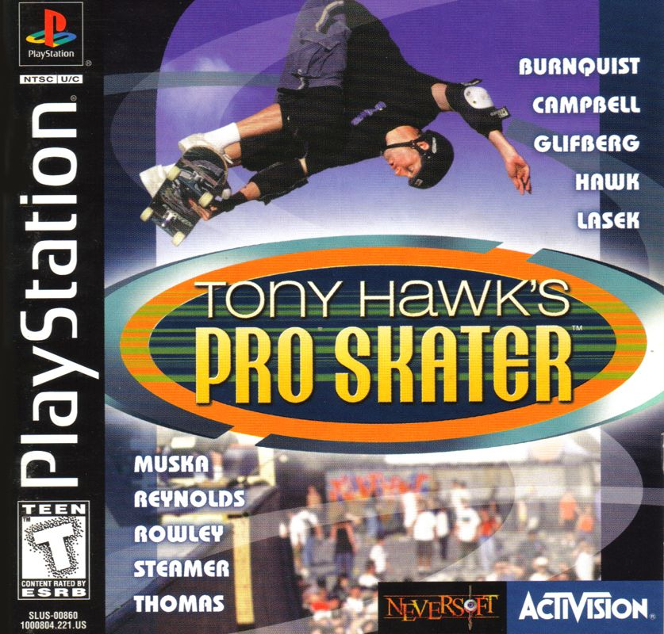
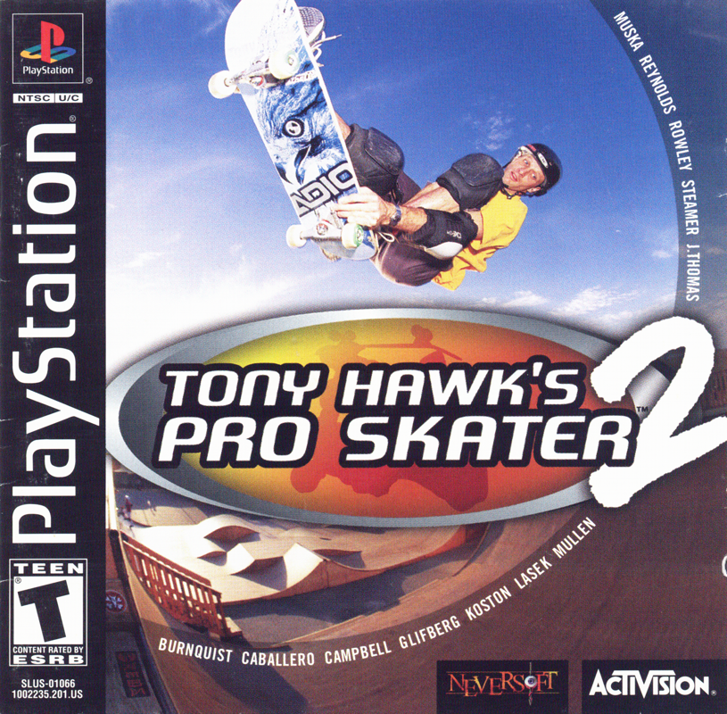

# Full Moon Issue

<ul>
    <li>
        <a href="https://github.com/fullmoonissue">
            GitHub
        </a>
    </li>
    <li>
        <a href="https://youtube.com/playlist?list=PLOritzM6b1Y_XC8kF1H1geVW2fAlfaBZA">
            [Playlist] Tool-Assisted Speedruns
        </a>
    </li>
</ul>

## TASed games

<table>
    <tr>
        <td align="center">
            
        </td>
        <td align="center">
            
        </td>
        <td align="center">
            
        </td>
    </tr>
    <tr>
        <td>
            <ul>
                <li>
                    <a href="https://www.youtube.com/watch?v=-A52Z8ZELXE">
                        TAS, Sultan's Wealth (No Duplicate Points), 18m&nbsp;27s
                    </a>
                </li>
            </ul>
        </td>
        <td>
            <ul>
                <li>
                    <a href="https://www.youtube.com/watch?v=Kxq-E8L_lfY">
                        TAS, Any%, 30m&nbsp;44s
                    </a>
                </li>
            </ul>
        </td>
        <td>
            <ul>
                <li>
                    <a href="https://www.youtube.com/watch?v=kPTkihZGlrY">
                        TAS, 100 puzzles, Speed&nbsp;:&nbsp;2, 10m&nbsp;29s
                    </a>
                </li>
                <li>
                    <a href="https://www.youtube.com/watch?v=_7yKOdAjblM">
                        TAS ILs, 100 puzzles, Speed&nbsp;:&nbsp;5, 7m&nbsp;49s
                    </a>
                </li>
                <li>
                    <a href="https://www.youtube.com/watch?v=LMxgXYxKpno">
                        TAS ILs, 100 puzzles, Maximum Stars (30), Speed&nbsp;:&nbsp;5, 8m&nbsp;50s
                    </a>
                </li>
                <li>
                    <a href="https://www.youtube.com/watch?v=dPKOuuCzq54">
                        TAS ILs, 100 puzzles, Minimum Steps (678), Speed&nbsp;:&nbsp;5, 8m&nbsp;58s
                    </a>
                </li>
                <li>
                    <a href="https://www.youtube.com/watch?v=i5ZGqlyCbUs">
                        TAS, Trial (Coop), Score&nbsp;:&nbsp;999.999, Speed&nbsp;:&nbsp;2, 4m&nbsp;36s
                    </a>
                </li>
            </ul>
        </td>
    </tr>
    <tr>
        <td align="center">
            
        </td>
        <td align="center">
            
        </td>
        <td align="center">
            
        </td>
    </tr>
    <tr>
        <td>
            <ul>
                <li>
                    <a href="https://www.youtube.com/watch?v=Pk696KI5nLk">
                        TAS, Developers' Office, Hard, 1h&nbsp;07m&nbsp;31s
                    </a>
                </li>
                <li>
                    <a href="https://www.youtube.com/watch?v=sPKHSO0zpZ4">
                        TAS, Salvation (Good Ending), 53m&nbsp;18s
                    </a>
                </li>
            </ul>
        </td>
        <td>
            <ul>
                <li>
                    <a href="https://www.youtube.com/watch?v=e1RWETgbzBQ">
                        TAS, Lesson Mode, 100%, 21m&nbsp;06s
                    </a>
                </li>
                <li>
                    <a href="https://www.youtube.com/watch?v=tDp-lRBLIi8">
                        TAS, Home Run Mode, Maximum Score (700m)
                    </a>
                </li>
                <li>
                    <a href="https://www.youtube.com/watch?v=R-QgYA1QLpo">
                        TAS, Service Mode, Maximum Score (48100 points)
                    </a>
                </li>
                <li>
                    <a href="https://www.youtube.com/watch?v=3Q2vnzKDj90">
                        TAS, Taerget Mode, Maximum Score (9100 points)
                    </a>
                </li>
            </ul>
        </td>
        <td>
            <ul>
                <li>
                    <a href="https://www.youtube.com/watch?v=dwosvtHT-Ak">
                        TAS, Any%, 4m&nbsp;35s
                    </a>
                </li>
                <li>
                    <a href="https://www.youtube.com/watch?v=hB_RFwZ0mi0">
                        TAS, Softlock%, 1m&nbsp;19s
                    </a>
                </li>
            </ul>
        </td>
    </tr>
    <tr>
        <td align="center">
            
        </td>
        <td align="center">
            
        </td>
        <td align="center">
            
        </td>
    </tr>
    <tr>
        <td>
            <ul>
                <li>
                    <a href="https://www.youtube.com/watch?v=dv51wUhmf4A">
                        TAS, 100%, 1h&nbsp;17m&nbsp;12s
                    </a>
                </li>
                <li>
                    <a href="https://www.youtube.com/playlist?list=PLOritzM6b1Y-63R0f3N9tpRvFlD6ruwkn">
                        [Playlist] TAS, 100%, ILs with commentaries
                    </a>
                </li>
            </ul>
        </td>
        <td>
            <ul>
                <li>
                    <a href="https://www.youtube.com/watch?v=kJsmPe_-otw">
                        TAS, Treasure Collector, 55m&nbsp;49s
                    </a>
                </li>
                <li>
                    <a href="https://www.youtube.com/watch?v=tAuSDgnDreg">
                        TAS, Max Vitality, 57m&nbsp;26s
                    </a>
                </li>
                <li>
                    <a href="https://www.youtube.com/watch?v=oO9NTIxUjJ0">
                        TAS, Maximum Adventure Points (Pacifist), 1h&nbsp;42m&nbsp;03s
                    </a>
                </li>
            </ul>
        </td>
        <td>
            <ul>
                <li>
                    <a href="https://www.youtube.com/watch?v=jLQcGUl01io">
                        TAS, Career Mode, 30 tapes - 3 gold medals - 63 bonus points - 137 gaps, 14m&nbsp;29s (IGT)
                    </a>
                </li>
                <li>
                    <a href="https://www.youtube.com/playlist?list=PLOritzM6b1Y8ToVXkLwGypGXRIYSX8jMp">
                        [Playlist] TAS, Career Mode, 30 tapes - 3 gold medals - 63 bonus points - 137 gaps, ILs with overlay
                    </a>
                </li>
                <li>
                    <a href="https://www.youtube.com/watch?v=5Kb-KNa_x30">
                        TAS, 2 players, 88 gaps, 4m&nbsp;07 (IGT)
                    </a>
                </li>
            </ul>
        </td>
    </tr>
    <tr>
        <td align="center">
            
        </td>
        <td align="center">
            &nbsp;
        </td>
        <td align="center">
            &nbsp;
        </td>
    </tr>
    <tr>
        <td>
            <ul>
                <li>
                    <a href="https://www.youtube.com/watch?v=GPc7dy4fRXE">
                        TAS, Career Mode, All goals - gold medals - cash - gaps, 27m&nbsp;19s
                    </a>
                </li>
                <li>
                    <a href="https://www.youtube.com/watch?v=tbVXB6hMgUw">
                        TAP, Unlock Skate Heaven (multiple careers with constraints)
                    </a>
                </li>
                <li>
                    <a href="https://www.youtube.com/watch?v=uBWtrogepFA">
                        TAP, Private's career 100% + All Gaps on Chopper Drop & Skate Heaven
                    </a>
                </li>
            </ul>
        </td>
        <td>
            &nbsp;
        </td>
        <td>
            &nbsp;
        </td>
    </tr>
</table>

Covers retrieved from <a href="https://www.mobygames.com">mobygames.com</a>.

